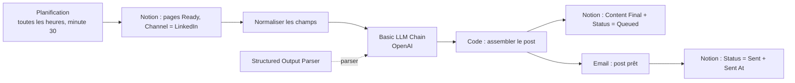

# Préparation de posts LinkedIn depuis Notion (n8n + OpenAI)

> **EN:** Draft n8n workflow that picks "Ready" LinkedIn ideas from a Notion database, turns each raw note into a structured post (hook, body, CTA, hashtags) with an LLM, emails the final text and updates the Notion status.
> **EN:** It does not post to LinkedIn: publishing stays manual, a deliberate choice because LinkedIn's API is restrictive for personal profiles.
> **EN:** Status: draft, not tested end to end.

**FR :** Workflow n8n (brouillon) qui lit dans Notion les idées de post au statut « Ready », génère un post LinkedIn structuré avec un LLM, envoie le texte final par email et met à jour le statut dans Notion. La publication reste manuelle.

## Problème → Solution → Pour qui

- **Problème :** les idées de posts restent à l'état de notes brutes, et la mise en forme (accroche, appel à l'action, hashtags) prend du temps.
- **Solution :** une file Notion alimente un prompt qui renvoie un JSON structuré ; le post final est envoyé par email et enregistré dans Notion.
- **Pour qui :** indépendants et consultants qui gèrent leur contenu LinkedIn dans Notion. La publication automatique (API LinkedIn) est une évolution possible, pas incluse.

## Résultat

Aucune sortie générée n'est versionnée. Format produit par le parseur, assemblé en un texte `Content Final` : `hook`, `body`, `cta`, `hashtags`, `content_final`. L'email reçu a pour objet « Post LinkedIn prêt - {topic} ».

<!-- TODO capture: une ligne Notion avant/après (Status Ready → Sent, Content Final rempli) et l'email reçu -->

## Architecture

## Prérequis

- n8n avec les nœuds LangChain ; version minimale non vérifiée.
- Credentials : Notion, OpenAI, SMTP (envoi de l'email).
- Une base Notion « LinkedIn Content Queue » (`notion-schema.md`).
- Coût : un appel LLM par post ; non calculé.

## Installation

1. Créer la base Notion selon `notion-schema.md` et la partager avec l'intégration.
2. Importer `linkedin-publisher-notion-v1.json` dans n8n.
3. Remplacer `<YOUR_NOTION_DATABASE_ID>`, `<YOUR_SENDER_EMAIL>` et `<YOUR_EMAIL>` (voir tableau).
4. Associer les credentials Notion, OpenAI et SMTP.
5. Dans le nœud de lecture Notion, remplacer la date fixe du filtre `Publish At` (voir limites).
6. Mettre une page de test à `Status = Ready`, `Channel = LinkedIn`, puis **Execute workflow**.
7. Vérifier l'email et le statut Notion, puis activer le workflow.

## Configuration

| Placeholder | Où le trouver | Nœud concerné |
|---|---|---|
| `<YOUR_NOTION_DATABASE_ID>` | URL de la base Notion (32 caractères) | Get many database pages |
| `<YOUR_SENDER_EMAIL>` | adresse d'expéditeur de votre SMTP | Send an Email (From) |
| `<YOUR_EMAIL>` | adresse qui reçoit le post prêt | Send an Email (To) |
| Credentials Notion, OpenAI, SMTP | n8n → Credentials | nœuds correspondants |

## Statut et limites

- **Statut : brouillon, non testé de bout en bout.** Le fichier JSON `linkedin-publisher-notion-v1.json` est un export n8n du workflow `linkedin-publisher-v1`.
- Le filtre de lecture Notion contient une **date fixe** (`Publish At` après le 2026-04-24) au lieu de « maintenant » comme décrit dans `n8n-setup-guide.md` : à modifier avant usage.
- La planification du JSON est horaire (minute 30), alors que le guide cite des horaires fixes (8h30, 12h30, 18h30).
- Le guide décrit une branche d'erreur (`Status = Error`) qui n'existe pas dans le JSON exporté.
- Le nœud de mise à jour écrit la propriété `Sent At ` avec un espace final : nommez la propriété ainsi, ou corrigez le nœud.
- Le workflow ne publie pas sur LinkedIn ; une publication via l'API nécessite généralement des droits supplémentaires (souvent une page entreprise).

## Fichiers

`notion-schema.md` (schéma de la base), `n8n-setup-guide.md` (construction pas à pas), `prompt-linkedin.md` (prompt).

## Licence

MIT, voir [LICENSE](LICENSE).
